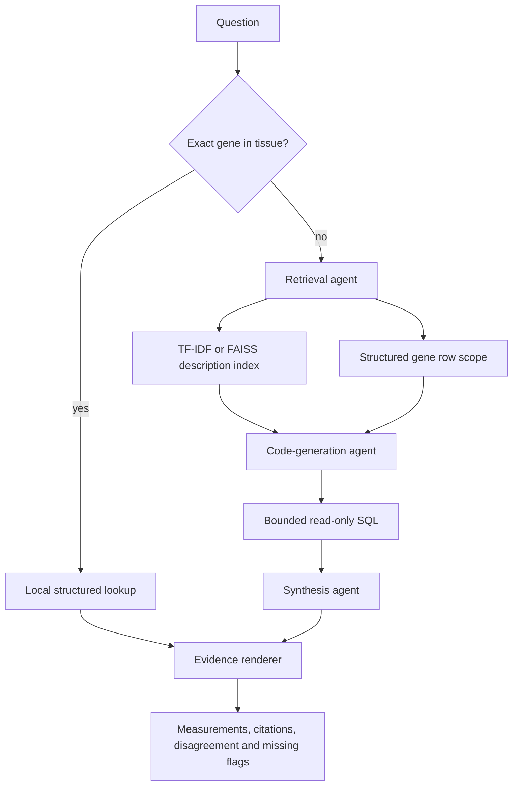

# How I keep the answers tied to evidence

I use LangChain's `create_agent` three times with different system prompts and tool sets. Each stage is a real model/tool loop: the model chooses a tool call, LangChain executes it, and the model sees the result. The stages run in order and use request-local tool outputs. The same `BaseChatModel` interface supports the deterministic mock and `ChatOllama`.

## Retrieval

`store.py` verifies the extract checksum, loads an in-memory SQLite database, and indexes 60 short dataset descriptions: one per gene and source. I wrote the source descriptions from the published methods and add the actual tissue coverage. LangChain `InMemoryVectorStore` performs cosine search over local `TfidfEmbeddings`. This remains the default source-level lexical index. With `--retrieval embedding` or `hybrid`, the same tool ranks individual measurement descriptions using the additional FAISS path described in [retrieval.md](retrieval.md). The `--search` command compares all three methods on those measurement descriptions. Gene matching uses whole symbols, case-insensitively. The tool returns up to six relevant descriptions plus the structured scope of row IDs for explicitly named supported genes. The model cannot expand that gene scope by inventing another gene.

The vector search explains the dataset and its limitations; the structured lookup is the authority for expression values. No network access is required at runtime with the mock.

## Generated code

The code agent writes SQL rather than arbitrary Python. `run_expression_sql` accepts only a `SELECT` under 4,000 characters. SQLite's authorizer denies writes, functions, other tables, pragmas, and extension loading. A VM instruction budget interrupts expensive queries, and a lock serializes SQL execution when LangChain calls tools on worker threads.

Only a single `id` column may be returned, with at most 100 rows, all inside the retrieved gene scope. The app reloads every measurement from its trusted row map, so a SQL expression cannot supply a fabricated nTPM value. Source and tissue filters, ordering, and row limits are generated code that actually selects the answer evidence. Errors fail closed; no fallback model-written answer is printed.

For rankings I use consensus to avoid counting each tissue three times. The output presents the selected top tissues; SQL in the JSON records their ranking order. A rank-only answer warns that independent measurements were not selected. Comparisons keep all available sources.

## Synthesis

The synthesis agent calls `compose_answer` with the complete evidence ID list and a grouping choice. The tool rejects any omitted, duplicated, or invented ID. I deliberately constrain the output to source facts and calculated caveats instead of accepting unverified model prose. The renderer merges sources by gene and tissue, links every measurement to its source archive, and flags HPA versus GTEx differences when both the ratio is at least two and the absolute difference is at least 1 nTPM. Zero values remain zero. A missing source is labelled missing; an empty result explicitly says that absence is not zero expression.

This protects measurement and citation integrity, but it cannot guarantee that an arbitrary live model chose the right SQL for every question. The visible SQL and rows support inspection. The scope is the bundled normal-tissue RNA extract; I make no clinical or causal inferences.

## Routing and accounting

The cheap route accepts only a narrow, complete `GENE in tissue` grammar, optionally prefixed by `lookup` or `What is` and with `expression`. A comparison or ranking cannot enter it. It uses the same evidence renderer, with zero model calls. `--force-agents` exercises the full path for the same lookup.

Every model call records its stage, prompt template version, message hash, prompt size, and input/output token counts. Ollama returns native usage metadata. Without provider metadata I use a labelled character-count estimate, not a billing claim. Prompt sizes and hashes describe the messages seen by the callback; tool schema and provider framing overhead are excluded from that estimate. Full prompts and keys are not saved. `--usage-log` is explicit because it records the user's question locally. The JSON output contains the same per-call accounting and a question total.

Each stage has an eight-step graph recursion limit; questions are limited to 2,000 characters. Ollama requests use temperature zero, a 16,384-token context, and at most 1,024 generated tokens per call. I set `keep_alive=0` so this CLI does not retain model weights after requests. It never starts, stops, or reconfigures an Ollama server.

## What the evaluation establishes

The 30 frozen cases cover 10 exact lookups, 10 two-tissue comparisons, five top-three rankings, and five missing/unsupported questions. Expected measurements and source IDs are stored in `data/evaluation.json`, separately from the answer code. Evaluation checks every returned measurement, source coverage, citation coverage, and missing-evidence flags. Regression tests separately check the three distinct tool loops, provider accounting, SQL restrictions, a VM timeout, multiple genes, explicit zero, and equivalence of the cheap and full routes.

`omics-rag --evaluate` uses the deterministic mock by default. `omics-rag --evaluate --model MODEL` uses the same cases with a live model and exits nonzero on any mismatch. The mock score tests the plumbing and supported patterns, not general natural-language understanding. The live smoke result in [live-run.md](live-run.md) is narrower and reported separately.

I use the [LangChain agent API](https://docs.langchain.com/oss/python/langchain/agents) and [LangChain's vector store interface](https://reference.langchain.com/python/langchain-core/vectorstores/) in the working path. Dependencies are locked in `uv.lock`. CI builds and installs a wheel outside the checkout so missing package data cannot hide behind editable imports.
